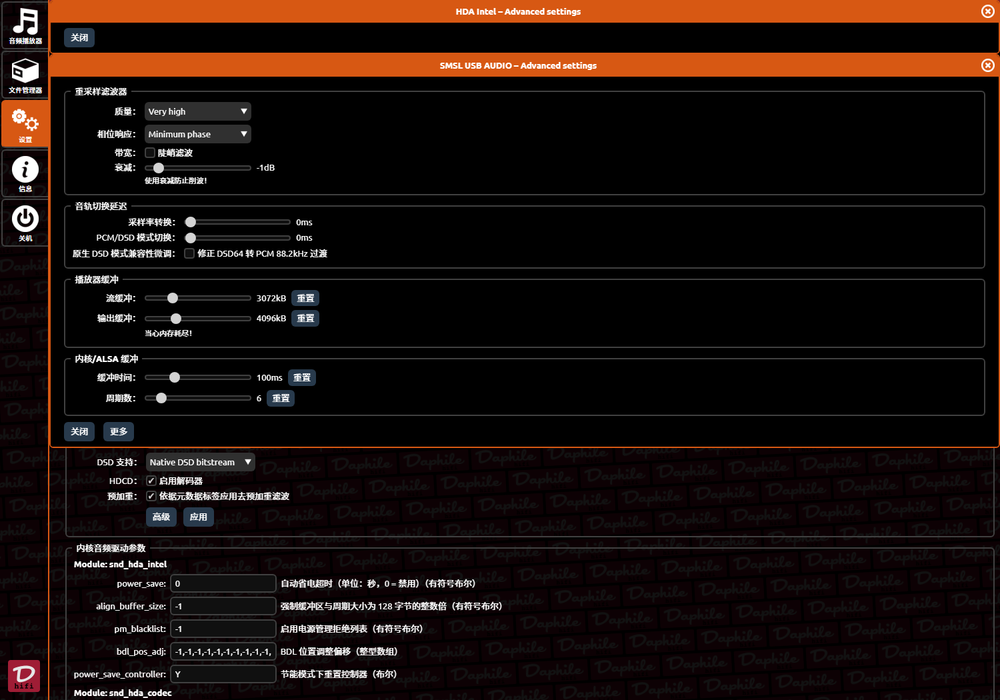

# daphile-zh

> [Daphile](https://daphile.com)（Linux 上的 Lyrion Music Server / Logitech Media Server 衍生发行版）简体中文本地化包
>
> 目标：**不逐页手工翻译**，而是建立三层翻译体系 + 自动同步机制，让任何界面（包括未来新装的插件）都能自动汉化。



---

## 这是什么

一套面向 Daphile / LMS 的中文本地化方案，包含：

| 组件 | 说明 |
|---|---|
| **三层词表** | 分层存放不同来源的译文，见 [词表体系](#词表体系) |
| **`zh-cn.js`** | 浏览器端翻译层，处理 DOM 文本、主题适配、UI 增强 |
| **`zh-plugin-sync`** | 自动同步器：扫描插件字符串 → 补译文 → 写入，开机自动运行 |
| **`patch-strings.py`** | 主 `strings.txt` 补丁工具（只补缺失，不覆盖已有） |
| **扫描工具** | 抓取界面残留英文并反查对应 key，产出待译清单 |

---

## 快速开始

### 部署

```bash
# 1. 主 strings.txt 补丁（需要先从设备取回当前 strings.txt）
scp daphile:/opt/mediaserver/strings.txt ./strings-remote.txt
python3 scripts/patch-strings.py strings-remote.txt glossary/lms-core.json
scp strings-remote.txt daphile:/opt/mediaserver/strings.txt

# 2. 部署 DOM 翻译层到两个位置（原因见 docs/architecture.md）
scp web/zh-cn.js daphile:/var/www/localhost/htdocs/js/zh-cn.js
scp web/zh-cn.js daphile:/opt/mediaserver/HTML/Daphile/js/zh-cn.js

# 3. 部署插件同步器 + 词库
scp scripts/zh-plugin-sync.py daphile:/usr/local/bin/zh-plugin-sync
scp glossary/plugins.json daphile:/var/daphile/zh-plugin-zh.json
chmod +x daphile:/usr/local/bin/zh-plugin-sync

# 4. 重启 LMS
ssh daphile '/etc/init.d/mediaserver restart'
```

详细步骤见 [docs/deploy.md](docs/deploy.md)。

### 新装插件后自动汉化

```bash
# 把该插件的译文加进 glossary/plugins.json，然后：
ssh daphile 'zh-plugin-sync && /etc/init.d/mediaserver restart'
```

同步器已挂在 `mediaserver` 的 `start_pre()`，**重启 LMS 时自动运行**，无需手动干预。

---

## 词表体系

界面文字有三种来源，分别对应三个词表文件。**判断新词条该放哪里**是本项目最关键的一件事。

| 词表 | 适用 | 例子 | 写入目标 |
|---|---|---|---|
| `glossary/lms-core.json` | LMS 自带界面的 strings key | `SETUP_PASSWORD_REPEAT` → 确认密码 | 主 `strings.txt` |
| `glossary/plugins.json` | 插件 strings key | `PLUGIN_RAOPBRIDGE_AUTORUN` → 启动桥接 | 各插件自己的 `strings.txt` |
| `glossary/dom-zh.json` | 硬编码 / 动态菜单 / 无 key 的文本 | `My Presets` → 我的预设 | 由 `zh-cn.js` 在 DOM 层翻译 |

详细判别规则见 [docs/architecture.md](docs/architecture.md#三层模型)。

### ⚠️ `_generic` 通用词条的陷阱

`plugins.json` 里的 `_generic` 段会按 **key 尾段**自动匹配：

```
PLUGIN_XXX_MODULE_NAME  → 尾段 "NAME"  →  命中 _generic.NAME  →  "名称"  ★ 误填
```

**尾段相同不代表语义相同**：`..._MODULE_NAME` 是模块名，`..._PLAYERNAME` 是表单字段名。

> 已在 `NAME` / `PORT` / `LEVEL` / `MODE` / `SERVER` / `INTERFACE` 等易误伤的词上禁用尾段匹配。
> `_generic` 里**只应保留语义无歧义的开关类词**（`YES` / `NO` / `ENABLE` / `SAVE` / `CANCEL`）。
> 其余一律显式写完整 key。

---

## 工作流：发现 → 翻译 → 验证

### 1. 扫描残留英文

```bash
# 抓取设置页 + 插件页的英文，反查 strings key
python3 scripts/scan.py <host> --out need-translate.json
```

输出形如 `{"KEY": "English text"}`，可直接对着翻译。

> **不要用 Playwright 抓渲染后的 DOM** —— 等久了 `zh-cn.js` 已把能翻的翻掉，
> 等短了 DOM 还没渲染全。**直接 HTTP 抓服务端渲染的 HTML** 才是准的。

### 2. 判断属于哪一层 → 补进对应词表

见上方[词表体系](#词表体系)。判断规则与翻译规范见 [docs/contributing.md](docs/contributing.md)。

### 3. 本地自检（等同 CI 会跑的检查）

```bash
python3 scripts/validate-glossary.py   # 词表规范
python3 scripts/scan-secrets.py        # 凭据泄漏
python3 scripts/coverage-report.py     # 覆盖率统计
```

### 4. 应用并验证

```bash
python3 scripts/patch-strings.py strings-remote.txt glossary/lms-core.json
python3 scripts/merge-dict.py web/zh-cn.js glossary/dom-zh.json dom
# 部署 → 重启 → 浏览器验证
```

---

## CI 自动校验

每次 push 与 PR 会自动跑 9 项检查（`.github/workflows/ci.yml`）：

| # | 检查 | 阻断 | 拦住什么 |
|---|---|---|---|
| 1 | 词表 JSON 合法性 | ✅ | JSON 语法错误 |
| 2 | 词表规范 | ✅ | 占位符丢失、HTML 标签丢失、未翻译、`_generic` 禁用词 |
| 3 | Python 脚本语法 | ✅ | 语法错误 |
| 4 | zh-cn.js 语法 | ✅ | 语法错误 |
| 5 | 换行符必须 LF | ✅ | **CRLF 会让 LMS 解析 strings.txt 出错** |
| 6 | 凭据泄漏扫描 | ✅ | 令牌、私钥、真实内网 IP、代理凭据、误提交的文件 |
| 7 | 覆盖率统计 | — | 信息性 |
| 8 | 工具 CLI 可用性 | — | 冒烟测试 |

### 提交 PR 前本地跑一遍

```bash
python3 scripts/validate-glossary.py && python3 scripts/scan-secrets.py
```

两项都过，CI 大概率也是绿的。

### Issue / PR 模板

| 模板 | 用途 |
|---|---|
| **词条补充** | 引导判断三层归属、附翻译规范清单 |
| **Bug 报告** | 附诊断命令（状态、条目数、文件位置、日志） |
| **新插件汉化请求** | 附扫描命令，让提交者直接贴待译清单 |
| **PR 模板** | 自查清单含「是否修改 `_generic`」必答项 |

---

## 项目结构

```
.
├── README.md                   # 本文件
├── docs/
│   ├── architecture.md         # 三层模型、注入点、主题机制
│   ├── deploy.md               # 部署与验证流程
│   ├── troubleshooting.md      # 已知问题与排查手册
│   └── contributing.md         # 贡献指南 / 词表规范
├── glossary/                   # 词表（唯一数据源）
│   ├── lms-core.json           #   LMS 主库 key
│   ├── plugins.json            #   插件 key + _generic 段
│   ├── dom-zh.json             #   DOM 层文本
│   └── ui-zh.json              #   设置界面（已并入 lms-core，保留供查阅）
├── scripts/
│   ├── patch-strings.py        # 主 strings.txt 补丁（只补不覆盖）
│   ├── zh-plugin-sync.py       # 插件自动同步器（开机自启）
│   ├── merge-dict.py           # DOM 词表 → zh-cn.js
│   ├── scan.py                 # 扫描残留英文 + 反查 key
│   ├── find-keys.py            # 英文 → key 反查工具
│   ├── validate-glossary.py    # 词表规范校验（CI 用）
│   ├── scan-secrets.py         # 凭据泄漏扫描（CI 用）
│   └── coverage-report.py      # 覆盖率统计
├── .github/
│   ├── workflows/ci.yml        # CI：9 项自动校验
│   └── ISSUE_TEMPLATE/         # 3 个 Issue 模板 + PR 模板
├── web/
│   └── zh-cn.js                # DOM 翻译层（含主题适配）
└── assets/                     # 截图、字体
```

---

## 当前状态

| 指标 | 数值 |
|---|---|
| 主 `strings.txt` 中文条目 | 1086 |
| 插件中文条目 | 240+ |
| DOM 层词条 | 90+ |
| 覆盖范围 | LMS 全部设置页 + 已安装/内置插件设置页 |

---

## 已知限制

- **`strings.txt` 只在 LMS 启动时读入内存**，改完必须重启 LMS 生效。
- **zh-cn.js 需在两个 webroot 各放一份**（详见 architecture）。
- **DOM 层无法翻译 `<input>` 的 `value` 属性**，除非写入时用 `title`/`placeholder` 承载。
- 插件升级后其 `strings.txt` 会被覆盖 → 重启时同步器会自动补回。
- 少数界面元素依赖 LMS 原生译文，**若上游自带译文有误**（如把 `Disabled` 译成"撤销"），
  `patch-strings.py` 不会覆盖，需要用修正工具单独处理。

---

## 致谢

- [Daphile](https://daphile.com) —— 优秀的 Linux 音频服务器发行版
- [Lyrion Music Server](https://lyrion.org) —— 上游社区版 LMS
- Noto Sans SC —— 中文字体

## 许可

词表与脚本以 MIT 许可发布。LMS / Daphile 本体版权归其作者所有。